# AIx Exchange-Duration Balance

Max WG duration is NOT a globally aligned makespan. Collective: stage-sum proxy (gaps omitted); P2P: continuous rank-local elapsed. No cross-rank clock alignment.

Narrative notes and statistics are README/caption-only in every graphic version. Numeric bar labels are retained. Saved canvases crop unused bottom space without stretching axes.

Output: 16 comparisons, each PNG/PDF; 32 figure files; no PGF. 4608 rank rows, 128 WG rows, 32 summaries.

For collective rank $r$, $e_r=1000(\mathrm{gather}_r+\mathrm{device}_r+\mathrm{scatter}_r)$ ms. Diagnostic barriers must be disabled (enabled barriers are rejected); arrival waits must be zero. Workers have zero device time; scatter already includes waiting, so controller device time is never added again. This stage SUM omits interstage gaps and is not a continuous observed interval.

For P2P, $e_r=1000(t_{r,\mathrm{end}}-t_{r,\mathrm{start}})$ uses only that rank's clock. Endpoints are unique scalars paired by full request identity, including valid zero-valued worker fields.

For each full-membership WG, $D_g=\max_{r\in g}e_r$. Exactly four WGs are required. Exchange-duration balance is $B=\frac{\sum_g D_g}{4\max_g D_g}$; 1 means even durations, not equal work, computational load balance, or completion-time skew. The right panel compares max(D_g), a proxy NOT a global makespan, with separately measured full MAIA ML-step elapsed.

Scope: AIx provider only; each P2P cell is bound to the collective baseline with the same model, placement, layout, repetition and selected call. Pairing requires exact full WG membership and GPU mapping, never rank intersection. Membership/controller/GPU selection comes from base.parse_mapping(solver.log); CSV communicator ranks are validated as a complete permutation with controller rank zero, not assumed equal to logged distribution order. Default GPU mapping uses logged node-local controller ranks; NUMA uses explicit GPU selections.

Selected repetition 1, diagnostic call 6 (inference call 7, MAIA step 189). Calls 0,1 are warmups; 2..6 are measured. These are individual representative calls, NOT averages over five measured calls or three repetitions; no CI. The shared collective baseline appears in both P2P comparisons and must not be counted as independent samples.

[Per-rank raw stages and scopes](per_rank_durations.csv), [WG maxima, worst rank and controller duration](workgroup_durations.csv), [balance and MAIA summaries](balance_summary.csv), [selected run rows and SHA256 input/source hashes](metadata.json). All member-rank diagnostic files are hashed.

## Gallery

### transformer | 96c4g | default | collective vs p2p1 | rep 1 | call 6 / MAIA step 189

[Vector PDF](transformer_96c4g_default_p2p1_r1_call6_exchange_balance.pdf)
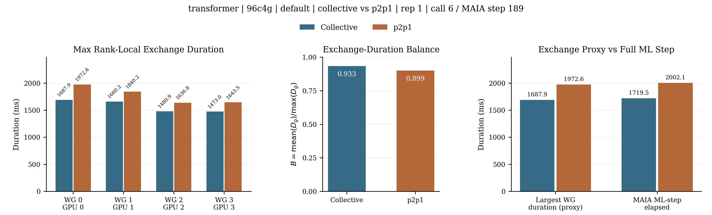

### transformer | 96c4g | default | collective vs p2pfull | rep 1 | call 6 / MAIA step 189

[Vector PDF](transformer_96c4g_default_p2pfull_r1_call6_exchange_balance.pdf)

### transformer | 96c4g | numa | collective vs p2p1 | rep 1 | call 6 / MAIA step 189

[Vector PDF](transformer_96c4g_numa_p2p1_r1_call6_exchange_balance.pdf)

### transformer | 96c4g | numa | collective vs p2pfull | rep 1 | call 6 / MAIA step 189

[Vector PDF](transformer_96c4g_numa_p2pfull_r1_call6_exchange_balance.pdf)
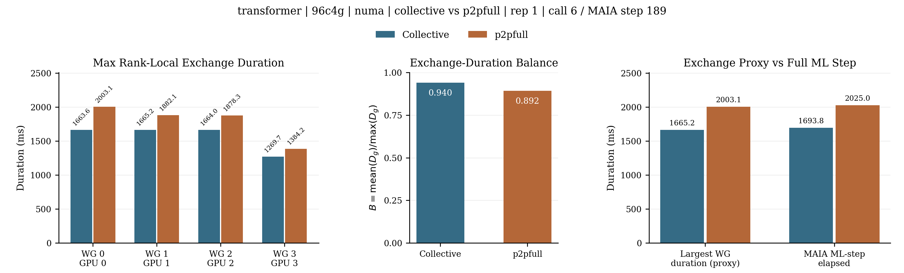

### transformer | 96p96c4g | default | collective vs p2p1 | rep 1 | call 6 / MAIA step 189

[Vector PDF](transformer_96p96c4g_default_p2p1_r1_call6_exchange_balance.pdf)

### transformer | 96p96c4g | default | collective vs p2pfull | rep 1 | call 6 / MAIA step 189

[Vector PDF](transformer_96p96c4g_default_p2pfull_r1_call6_exchange_balance.pdf)

### transformer | 96p96c4g | numa | collective vs p2p1 | rep 1 | call 6 / MAIA step 189

[Vector PDF](transformer_96p96c4g_numa_p2p1_r1_call6_exchange_balance.pdf)

### transformer | 96p96c4g | numa | collective vs p2pfull | rep 1 | call 6 / MAIA step 189

[Vector PDF](transformer_96p96c4g_numa_p2pfull_r1_call6_exchange_balance.pdf)
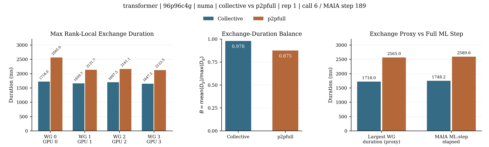

### mlp | 96c4g | default | collective vs p2p1 | rep 1 | call 6 / MAIA step 189

[Vector PDF](mlp_96c4g_default_p2p1_r1_call6_exchange_balance.pdf)
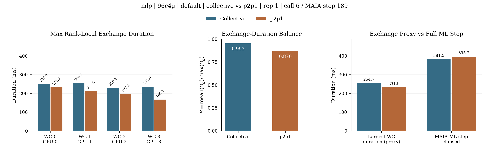

### mlp | 96c4g | default | collective vs p2pfull | rep 1 | call 6 / MAIA step 189

[Vector PDF](mlp_96c4g_default_p2pfull_r1_call6_exchange_balance.pdf)
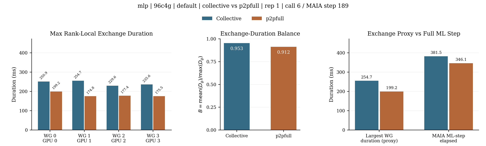

### mlp | 96c4g | numa | collective vs p2p1 | rep 1 | call 6 / MAIA step 189

[Vector PDF](mlp_96c4g_numa_p2p1_r1_call6_exchange_balance.pdf)
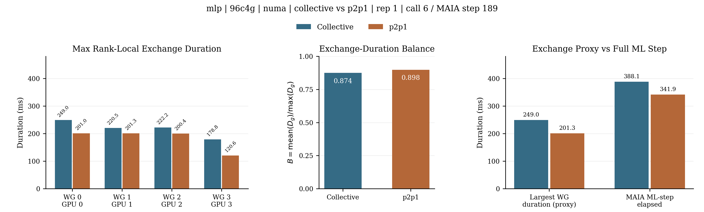

### mlp | 96c4g | numa | collective vs p2pfull | rep 1 | call 6 / MAIA step 189

[Vector PDF](mlp_96c4g_numa_p2pfull_r1_call6_exchange_balance.pdf)
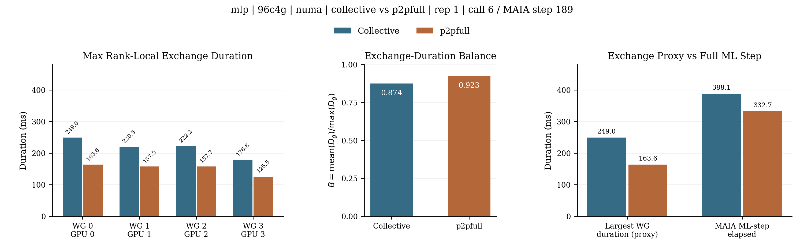

### mlp | 96p96c4g | default | collective vs p2p1 | rep 1 | call 6 / MAIA step 189

[Vector PDF](mlp_96p96c4g_default_p2p1_r1_call6_exchange_balance.pdf)
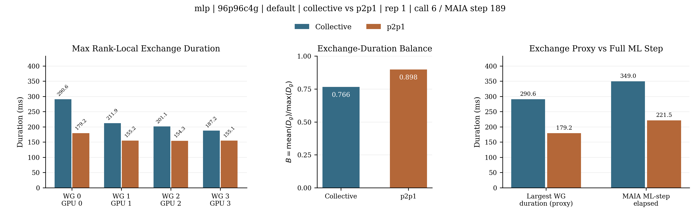

### mlp | 96p96c4g | default | collective vs p2pfull | rep 1 | call 6 / MAIA step 189

[Vector PDF](mlp_96p96c4g_default_p2pfull_r1_call6_exchange_balance.pdf)
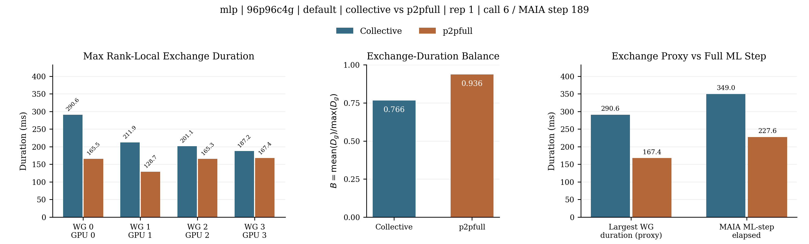

### mlp | 96p96c4g | numa | collective vs p2p1 | rep 1 | call 6 / MAIA step 189

[Vector PDF](mlp_96p96c4g_numa_p2p1_r1_call6_exchange_balance.pdf)
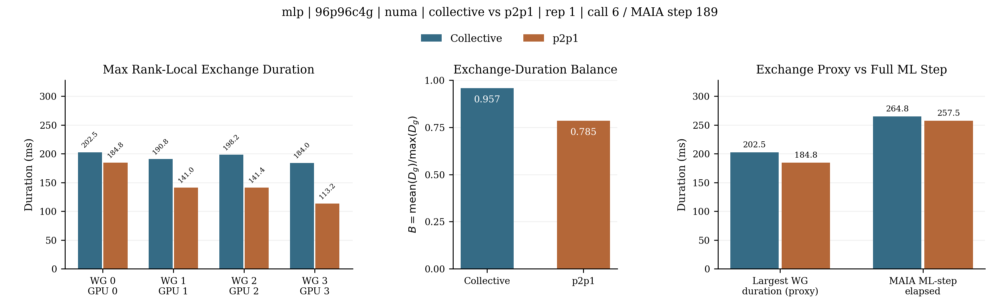

### mlp | 96p96c4g | numa | collective vs p2pfull | rep 1 | call 6 / MAIA step 189

[Vector PDF](mlp_96p96c4g_numa_p2pfull_r1_call6_exchange_balance.pdf)
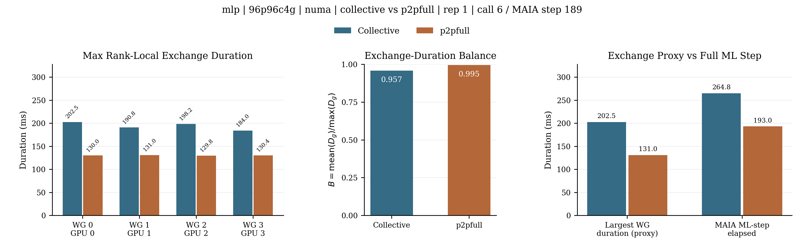

## Selected Sources

- `aix-96c4g-default-coll-transformer-r1`, job `5009530`: [solver.log](../../scratch/cmi_smokes/aix-collective_gpu_5009530_Gb07lW/solver.log)
- `aix-96c4g-default-p2p1-transformer-r1`, job `5009530`: [solver.log](../../scratch/cmi_smokes/aix-p2p1_gpu_5009530_xEFjgQ/solver.log)
- `aix-96c4g-default-p2pfull-transformer-r1`, job `5009530`: [solver.log](../../scratch/cmi_smokes/aix-p2pfull_gpu_5009530_d8UReH/solver.log)
- `aix-96c4g-numa-coll-transformer-r1`, job `5009530`: [solver.log](../../scratch/cmi_smokes/aix-collective_gpu_5009530_IpasOn/solver.log)
- `aix-96c4g-numa-p2p1-transformer-r1`, job `5009530`: [solver.log](../../scratch/cmi_smokes/aix-p2p1_gpu_5009530_avdsba/solver.log)
- `aix-96c4g-numa-p2pfull-transformer-r1`, job `5009530`: [solver.log](../../scratch/cmi_smokes/aix-p2pfull_gpu_5009530_4bOAsK/solver.log)
- `aix-96p96c4g-default-coll-transformer-r1`, job `5009534`: [solver.log](../../scratch/cmi_bench/aix-96p96c4g-default-coll-transformer-r1_5009534_6DvZ18/solver.log)
- `aix-96p96c4g-default-p2p1-transformer-r1`, job `5009534`: [solver.log](../../scratch/cmi_bench/aix-96p96c4g-default-p2p1-transformer-r1_5009534_kFiTgR/solver.log)
- `aix-96p96c4g-default-p2pfull-transformer-r1`, job `5009534`: [solver.log](../../scratch/cmi_bench/aix-96p96c4g-default-p2pfull-transformer-r1_5009534_3imolw/solver.log)
- `aix-96p96c4g-numa-coll-transformer-r1`, job `5009534`: [solver.log](../../scratch/cmi_bench/aix-96p96c4g-numa-coll-transformer-r1_5009534_cozQYB/solver.log)
- `aix-96p96c4g-numa-p2p1-transformer-r1`, job `5009534`: [solver.log](../../scratch/cmi_bench/aix-96p96c4g-numa-p2p1-transformer-r1_5009534_jNncF1/solver.log)
- `aix-96p96c4g-numa-p2pfull-transformer-r1`, job `5009534`: [solver.log](../../scratch/cmi_bench/aix-96p96c4g-numa-p2pfull-transformer-r1_5009534_8Ga6SO/solver.log)
- `aix-96c4g-default-coll-mlp-r1`, job `5046471`: [solver.log](../../scratch/cmi_smokes/aix-collective_gpu_5046471_ahXVA0/solver.log)
- `aix-96c4g-default-p2p1-mlp-r1`, job `5046471`: [solver.log](../../scratch/cmi_smokes/aix-p2p1_gpu_5046471_0WFVLM/solver.log)
- `aix-96c4g-default-p2pfull-mlp-r1`, job `5046471`: [solver.log](../../scratch/cmi_smokes/aix-p2pfull_gpu_5046471_OrfLXJ/solver.log)
- `aix-96c4g-numa-coll-mlp-r1`, job `5046471`: [solver.log](../../scratch/cmi_smokes/aix-collective_gpu_5046471_d28NTU/solver.log)
- `aix-96c4g-numa-p2p1-mlp-r1`, job `5046471`: [solver.log](../../scratch/cmi_smokes/aix-p2p1_gpu_5046471_bHMSG5/solver.log)
- `aix-96c4g-numa-p2pfull-mlp-r1`, job `5046471`: [solver.log](../../scratch/cmi_smokes/aix-p2pfull_gpu_5046471_ErGG4c/solver.log)
- `aix-96p96c4g-default-coll-mlp-r1`, job `5046475`: [solver.log](../../scratch/cmi_bench/aix-96p96c4g-default-coll-mlp-r1_5046475_itUKtu/solver.log)
- `aix-96p96c4g-default-p2p1-mlp-r1`, job `5046475`: [solver.log](../../scratch/cmi_bench/aix-96p96c4g-default-p2p1-mlp-r1_5046475_gBLB2f/solver.log)
- `aix-96p96c4g-default-p2pfull-mlp-r1`, job `5046475`: [solver.log](../../scratch/cmi_bench/aix-96p96c4g-default-p2pfull-mlp-r1_5046475_8uDGD0/solver.log)
- `aix-96p96c4g-numa-coll-mlp-r1`, job `5046475`: [solver.log](../../scratch/cmi_bench/aix-96p96c4g-numa-coll-mlp-r1_5046475_FY4ilM/solver.log)
- `aix-96p96c4g-numa-p2p1-mlp-r1`, job `5046475`: [solver.log](../../scratch/cmi_bench/aix-96p96c4g-numa-p2p1-mlp-r1_5046475_qMVjFi/solver.log)
- `aix-96p96c4g-numa-p2pfull-mlp-r1`, job `5046475`: [solver.log](../../scratch/cmi_bench/aix-96p96c4g-numa-p2pfull-mlp-r1_5046475_osw4pO/solver.log)
