# AIx Pipeline Spans Draft

Reproduce: `python scripts/plot_cmi_pipeline_spans.py`. All three layouts by default;
use `--layouts default affine numa` or a subset. No jobs, data edits, or commits.
Each model/hardware/layout has a 150 x 33.592 mm two-panel PGF/PDF/PNG figure.
Independent 73.5 x 33.592 mm subfigures are exported under panels/ as
<name>_stages and <name>_comparison, also in all three formats.
All exports are caption-free: no overall title, (a)/(b) headings, or explanatory
footers. Model, overlap, hardware and layout are identified by filenames and the
gallery headings so LaTeX can own captions. Interpretation and statistics below
belong in the accompanying thesis text or caption, not inside the graphic.
Plotting areas remain 20.592 mm high (60% of their original height). Both compact legends share one
row, left- and right-aligned respectively. Every bar is labeled with its mean in
seconds above the upper CI endpoint; labels are rounded to three significant figures.
The first eight gallery entries are the default-layout main figures.

## Definitions

Left: five collective stages from the SAME per-call WG selected by argmax sum(A),
consistent with export_cmi_aix_stage_tables.py, not independent stage maxima.
Five adjacent, zero-baseline columns show individual phase means and their own
95% repetition CIs, NOT stacked heights or the stage-sum CI. Short ticks identify
Gather, H2D, Fwd, D2H, Scatter; the legend spells out the phases. Colors match the
chapter-6 CPU phase palette: #4C78A8, #72B7B2, #F58518, #54A24B, #B279A2.
Panels use independent y scales: phase durations at left, full envelopes at right.
The reader-facing right-axis label is Inference time (s), including transfers;
the precise measured exchange scope remains defined below, not pure forward time.
The panel width ratio is 45:55. Right-hand groups are Collective 5-stage sum,
P2P Credit=1, and P2P Fullcredit; legend colors distinguish Predicted and Measured.
A = (1000*gather_collective_s, h2d_gpu_ms, forward_gpu_ms, d2h_gpu_ms,
1000*scatter_collective_s). Their means sum to the collective reference at right.
Gather/scatter are host-clock durations including wait/protocol/imbalance; the GPU
phases are CUDA-event sums over serial sub-batches. This mixed-instrument work sum
is not a directly measured five-stage elapsed interval. device_cpu_s is not added.

Right: collective B=max_g sum(A_g), then c1 ideal/measured and full ideal/measured.
Thesis chapter_optimizations.tex equations tau_step, tau_max, collective, pipelined:
P_g=sum(A_g)/N_g+(N_g-1)/N_g*max(A_g); P=max_g P_g. N includes the controller,
not GPU count. The ideal has NO credit term: the two ideal bars repeat exactly P,
not credit-specific forecasts. No residual is added, and no full MAIA ML-step time
is plotted. The predicted critical WG can differ from the collective critical WG.
Assumptions: rank homogeneity, operation independence, baseline equivalence,
unchanged batch efficiency, and no inter-WG contention. This is a conditional ideal
proxy, not a guaranteed bound on measured performance.

## Measured Exchange

Per controller/call: input_listen_start -> last result_send_complete. The former
is logged before receive posting (collectiveCommunication.cpp lines 296--312),
before credit grants (329--331), and before local input_ready (348--350). It is the
earliest explicit controller input activity, not a remote sender start timestamp.
The latter is logged per remote rank AFTER output MPI_Waitall (662--666), not at
individual worker receipt. The last log includes completion-marker loop overhead.
Local rank zero has input_ready and result_send_start but no result_send_complete;
its output is already local. We validate all N inputs, exactly-once inference-range
coverage (and paired H2D/forward/D2H request identities), all N output posts, and
N-1 grants/completions. No worker or controller-local request is dropped.
The local segment is already available; no local input-copy start is instrumented.
This envelope spans input/inference/output activity INCLUDING setup, scheduling,
waiting, logging and output completion protocol. It excludes initial function
setup before input_listen_start and final credit/ACK Waitalls after output done.
It is not pure stage service time, not a ready-range-only window, not the canonical
MAIA step, and not a synchronized global first-input-to-last-worker-receipt span.
There is no fallback to a silently broader ml_step interval: missing endpoints fail.

Subtract endpoints on EACH controller's own clock first, then take the maximum
local duration across WGs. This independent zero-origin envelope is not a global
makespan. No absolute timestamps from different clocks are subtracted, and no
causal clock alignment is assumed. Host-anchored CUDA timestamps are not used as
exchange endpoints. Comparing the mixed host/CUDA collective sum and ideal with
this host exchange is useful but instrument/scope differences remain explicit.

## Sampling And Audit

Canonical consolidated snapshot only: 288 runs / 2016 inference rows. All layouts
select 216 successful AIx runs, coll/c1/full, 2 models x 4 placements x 3 reps.
MLP ov4, Transformer ov0. Diagnostic calls 2..6 match inference calls 3..7 and MAIA
steps 73,102,131,160,189. Exact solver-log WG/GPU membership is validated across modes.
Per-call maxima/predictions precede five-call repetition means. Three independent
repetition means yield mean +/- 4.302652729911275*sample_SD/sqrt(3), 95% Student t,
df=2. Calls/GPUs are not independent samples. CIs express repetition variability,
not model uncertainty. Negative CI bounds remain visible, not clamped. Each left
CI is for that phase; right CIs are for envelope metrics. Hardware is not fixed-work scaling.

workgroup_calls.csv contains every WG/call with raw stages, memberships, sources,
and measured endpoints plus complete serialized endpoint row identities.
call_metrics.csv contains paired per-call reference/predictions/measurements and
all critical WG identities. summary_statistics.csv contains means, all three run
means, SD and CIs. metadata.json hashes consumed canonical files, diagnostics,
solver logs, thesis, guide, and code/style sources; hashes are recomputed on each run.
No existing exported CSVs, old figures, or metadata are used as cached results.

## Gallery

### mlp_24c1g_default_pipeline_spans
[PDF](mlp_24c1g_default_pipeline_spans.pdf) | [PGF](mlp_24c1g_default_pipeline_spans.pgf)


### mlp_24p24c1g_default_pipeline_spans
[PDF](mlp_24p24c1g_default_pipeline_spans.pdf) | [PGF](mlp_24p24c1g_default_pipeline_spans.pgf)

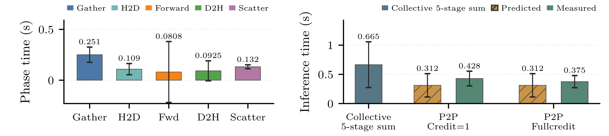

### mlp_96c4g_default_pipeline_spans
[PDF](mlp_96c4g_default_pipeline_spans.pdf) | [PGF](mlp_96c4g_default_pipeline_spans.pgf)

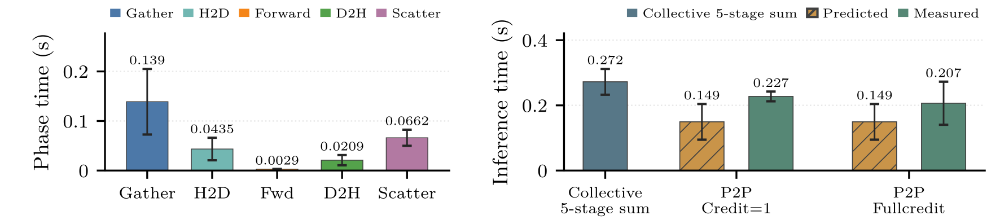

### mlp_96p96c4g_default_pipeline_spans
[PDF](mlp_96p96c4g_default_pipeline_spans.pdf) | [PGF](mlp_96p96c4g_default_pipeline_spans.pgf)

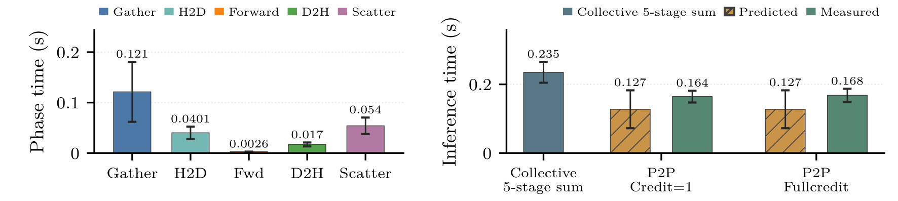

### transformer_24c1g_default_pipeline_spans
[PDF](transformer_24c1g_default_pipeline_spans.pdf) | [PGF](transformer_24c1g_default_pipeline_spans.pgf)

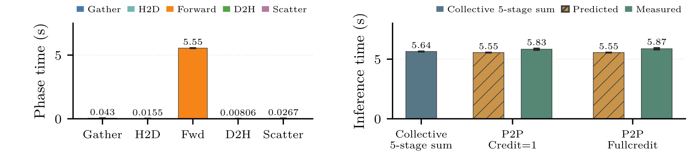

### transformer_24p24c1g_default_pipeline_spans
[PDF](transformer_24p24c1g_default_pipeline_spans.pdf) | [PGF](transformer_24p24c1g_default_pipeline_spans.pgf)

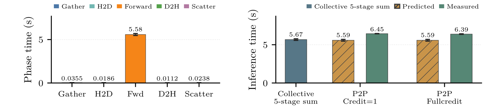

### transformer_96c4g_default_pipeline_spans
[PDF](transformer_96c4g_default_pipeline_spans.pdf) | [PGF](transformer_96c4g_default_pipeline_spans.pgf)

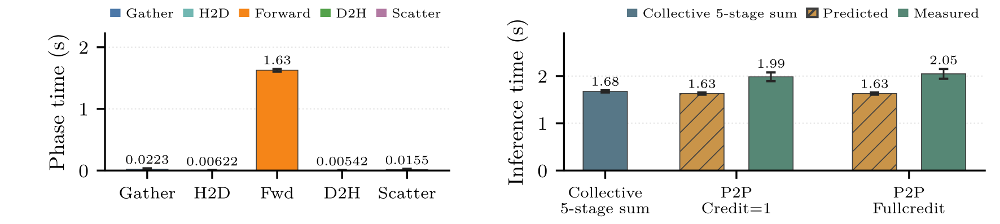

### transformer_96p96c4g_default_pipeline_spans
[PDF](transformer_96p96c4g_default_pipeline_spans.pdf) | [PGF](transformer_96p96c4g_default_pipeline_spans.pgf)

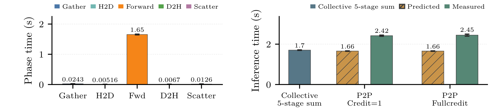

### mlp_24c1g_affine_pipeline_spans
[PDF](mlp_24c1g_affine_pipeline_spans.pdf) | [PGF](mlp_24c1g_affine_pipeline_spans.pgf)

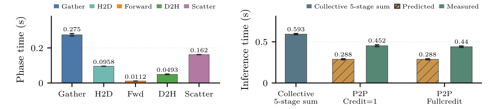

### mlp_24p24c1g_affine_pipeline_spans
[PDF](mlp_24p24c1g_affine_pipeline_spans.pdf) | [PGF](mlp_24p24c1g_affine_pipeline_spans.pgf)

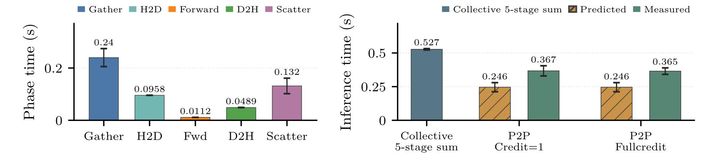

### mlp_96c4g_affine_pipeline_spans
[PDF](mlp_96c4g_affine_pipeline_spans.pdf) | [PGF](mlp_96c4g_affine_pipeline_spans.pgf)

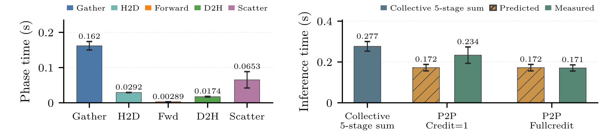

### mlp_96p96c4g_affine_pipeline_spans
[PDF](mlp_96p96c4g_affine_pipeline_spans.pdf) | [PGF](mlp_96p96c4g_affine_pipeline_spans.pgf)

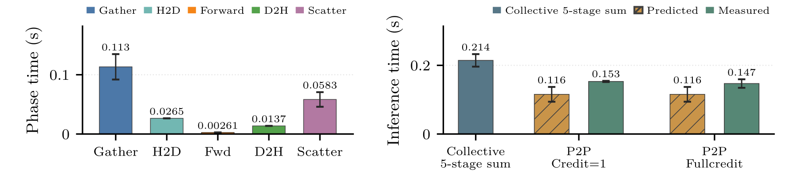

### transformer_24c1g_affine_pipeline_spans
[PDF](transformer_24c1g_affine_pipeline_spans.pdf) | [PGF](transformer_24c1g_affine_pipeline_spans.pgf)


### transformer_24p24c1g_affine_pipeline_spans
[PDF](transformer_24p24c1g_affine_pipeline_spans.pdf) | [PGF](transformer_24p24c1g_affine_pipeline_spans.pgf)

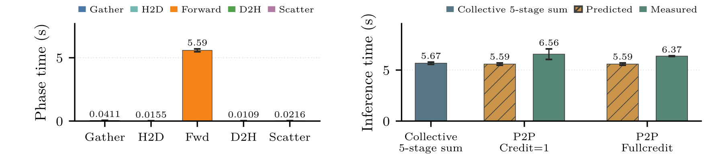

### transformer_96c4g_affine_pipeline_spans
[PDF](transformer_96c4g_affine_pipeline_spans.pdf) | [PGF](transformer_96c4g_affine_pipeline_spans.pgf)

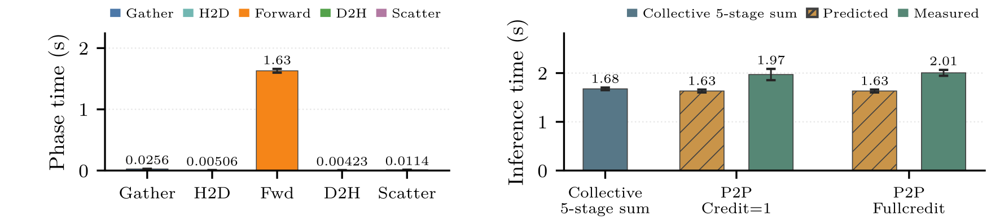

### transformer_96p96c4g_affine_pipeline_spans
[PDF](transformer_96p96c4g_affine_pipeline_spans.pdf) | [PGF](transformer_96p96c4g_affine_pipeline_spans.pgf)

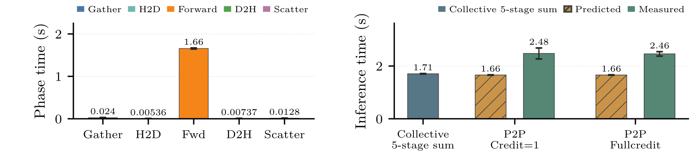

### mlp_24c1g_numa_pipeline_spans
[PDF](mlp_24c1g_numa_pipeline_spans.pdf) | [PGF](mlp_24c1g_numa_pipeline_spans.pgf)

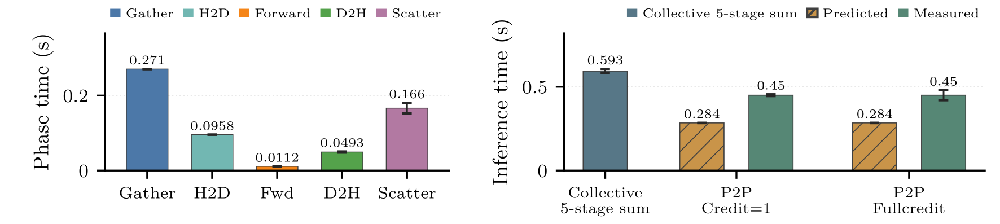

### mlp_24p24c1g_numa_pipeline_spans
[PDF](mlp_24p24c1g_numa_pipeline_spans.pdf) | [PGF](mlp_24p24c1g_numa_pipeline_spans.pgf)


### mlp_96c4g_numa_pipeline_spans
[PDF](mlp_96c4g_numa_pipeline_spans.pdf) | [PGF](mlp_96c4g_numa_pipeline_spans.pgf)

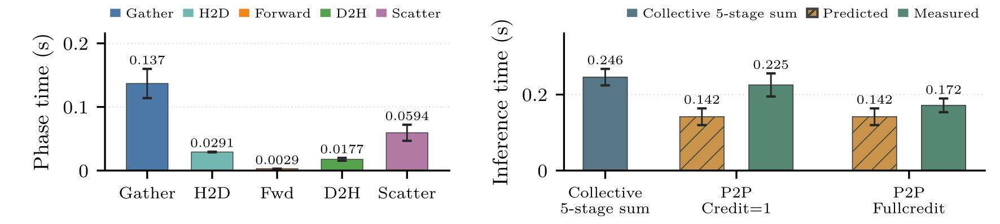

### mlp_96p96c4g_numa_pipeline_spans
[PDF](mlp_96p96c4g_numa_pipeline_spans.pdf) | [PGF](mlp_96p96c4g_numa_pipeline_spans.pgf)

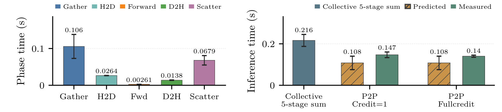

### transformer_24c1g_numa_pipeline_spans
[PDF](transformer_24c1g_numa_pipeline_spans.pdf) | [PGF](transformer_24c1g_numa_pipeline_spans.pgf)


### transformer_24p24c1g_numa_pipeline_spans
[PDF](transformer_24p24c1g_numa_pipeline_spans.pdf) | [PGF](transformer_24p24c1g_numa_pipeline_spans.pgf)


### transformer_96c4g_numa_pipeline_spans
[PDF](transformer_96c4g_numa_pipeline_spans.pdf) | [PGF](transformer_96c4g_numa_pipeline_spans.pgf)

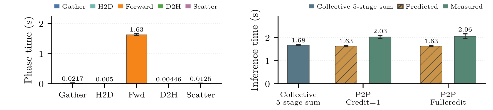

### transformer_96p96c4g_numa_pipeline_spans
[PDF](transformer_96p96c4g_numa_pipeline_spans.pdf) | [PGF](transformer_96p96c4g_numa_pipeline_spans.pgf)

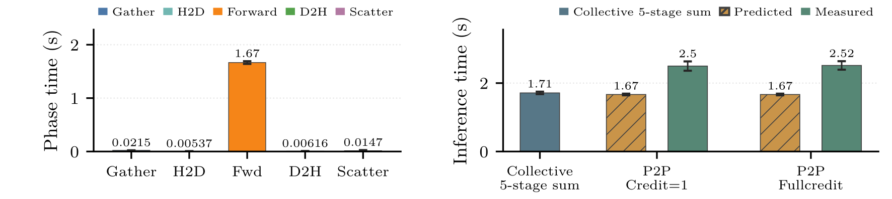

## Coverage
```json
{
  "selected_runs": 216,
  "workgroup_calls": 2700,
  "measured_workgroup_calls": 1800,
  "paired_calls": 360,
  "summary_rows": 240
}
```
