# AIx All-Rank Timeline Draft

Alignment: `causal`. One selected measured call, not repetition averages.

Aggregate plots use plot_cmi_aix_timeline.render_timeline, including its unchanged per-WG table and data; a save-time canvas/spacing adjustment prevents single-WG title/footer collisions. Dashed lines in aggregate views mark the independently zeroed collective duration reference, not recorded timestamps. Detailed plots show one controller (GPU lanes and observations) plus all 23 mapped workers. World-rank membership comes from the solver log; workgroup-local peer IDs come from each actual rank CSV, never sorted-member indices.

## Clock Evidence

Causal placement assumes a constant additive offset during this call: controller time = worker time + delta. Bounds are low=max(c_grant-w_send_start, c_ready-w_send_complete), high=c_ready-w_send_start; the midpoint is displayed, not a synchronized timestamp. Whiskers on both own-ML endpoints and rank-label +/- values show half the feasible interval; the same uncertainty shifts every bar endpoint. No exact transfer arrows are drawn. Infeasible bounds fail, never silently switch modes. No cross-call tightening or drift estimate is used.

Source: collectiveCommunication.cpp lines 239-260, 329-331, 398-409, 662-666. Grant is logged before MPI_Isend; worker send starts after receiving credit; input_ready follows input receipt and precedes posting ACK; worker send-complete follows ACK receipt. These orderings support the bounds. The source SHA256 is recorded. Logged grant is not a measured credit-receipt timestamp; no such event exists.

Local mode independently zeros each worker at its own ml_step_start and the controller at its own start. Controller marks stay exclusively on the top strip in that mode; row overlap implies no concurrency. Local alignment CSV delta bounds are empty, uncertainty is 0 for display only, not a claim of synchronization.

## Interpretation

Yellow spans credit-wait start to input-send start, including the receipt instrumentation gap. Blue includes blocking MPI_Send AND ACK wait. Orange includes result wait AND receive. Black ticks mark each rank's own ML endpoints. Controller symbols use the very same selected call's events: grant, ready before ACK, result post, and done logged after the ALL-output MPI_Waitall, never individual transfer completion. Symbols may overplot. CUDA-event durations are host anchored; inter-request overlap is approximate.

Collective G/D/S uses gather_collective, host device_cpu, scatter_collective durations concatenated from zero. Arrival waits and gaps are omitted. Dashed lines show schematic gather done and scatter start only, NOT observed collective timestamps or cross-run synchronization. The independent reference shares only the millisecond scale. All bars retain true widths. Axis limits include full worker ML spans plus offset uncertainty, including negative starts.

[Worker intervals](worker_intervals.csv): own-clock seconds, own-zero milliseconds, displayed milliseconds. [Alignment](alignment.csv): estimates/bounds, raw causal evidence, endpoint times and source paths. [Workgroup metrics](workgroup_metrics.csv), [controller events](events.csv), [metadata and SHA256 provenance](metadata.json), including all 24 rank files per comparison and inherited base provenance.

## Gallery

### transformer | 24c1g | default | collective vs p2p1 | rep 1 | call 6 / MAIA step 189

[timeline PDF](transformer_24c1g_default_p2p1_r1_call6_timeline.pdf)
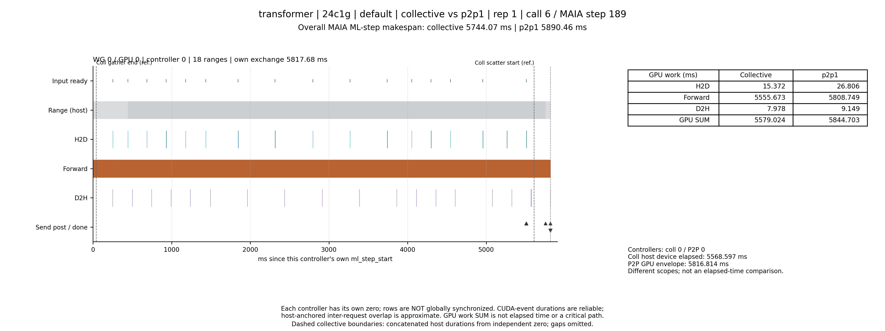

[rank_timeline PDF](transformer_24c1g_default_p2p1_r1_call6_rank_timeline.pdf)

### transformer | 24c1g | default | collective vs p2pfull | rep 1 | call 6 / MAIA step 189

[timeline PDF](transformer_24c1g_default_p2pfull_r1_call6_timeline.pdf)

[rank_timeline PDF](transformer_24c1g_default_p2pfull_r1_call6_rank_timeline.pdf)
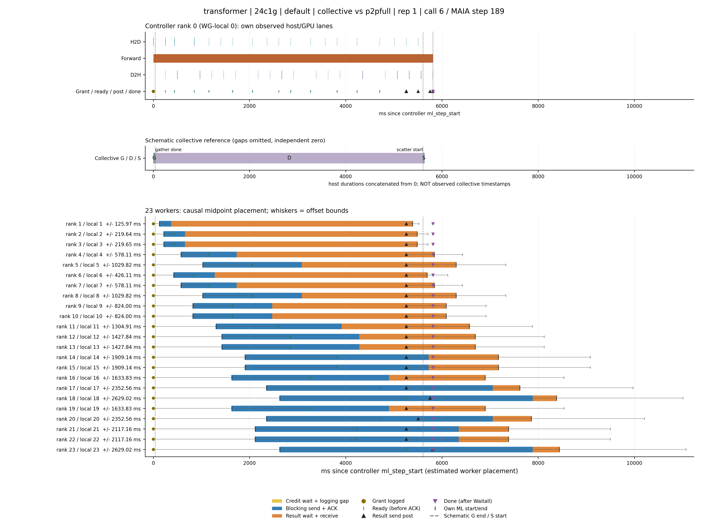

### transformer | 24c1g | numa | collective vs p2p1 | rep 1 | call 6 / MAIA step 189

[timeline PDF](transformer_24c1g_numa_p2p1_r1_call6_timeline.pdf)
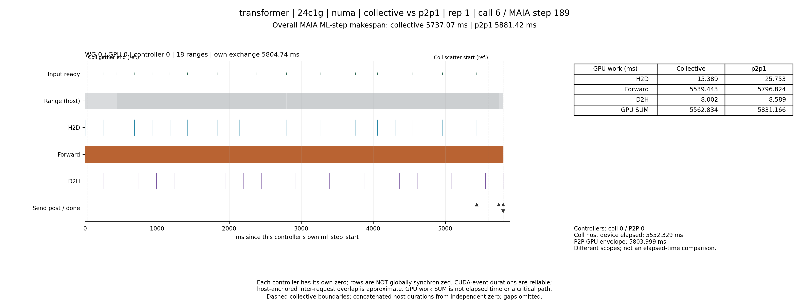

[rank_timeline PDF](transformer_24c1g_numa_p2p1_r1_call6_rank_timeline.pdf)
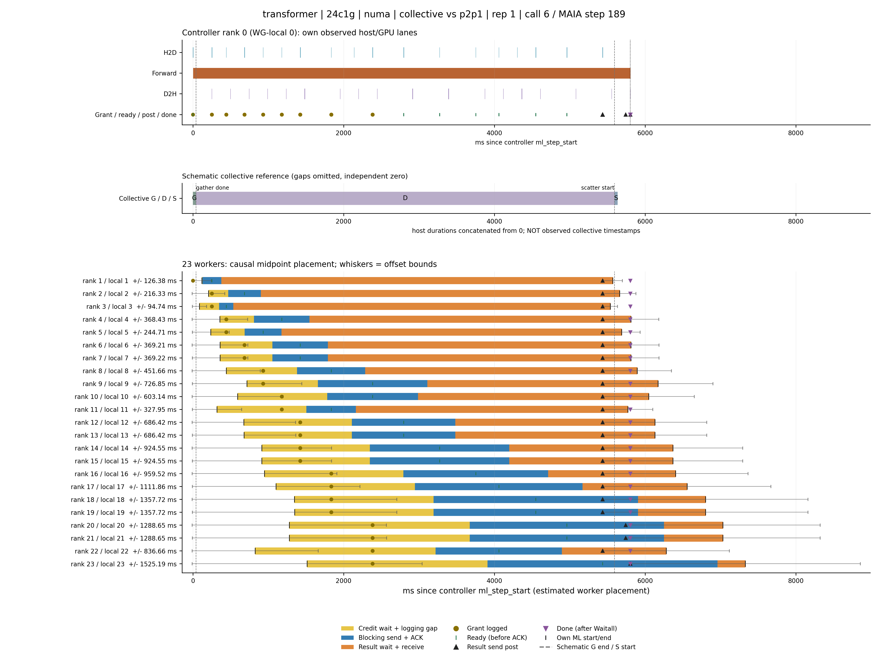

### transformer | 24c1g | numa | collective vs p2pfull | rep 1 | call 6 / MAIA step 189

[timeline PDF](transformer_24c1g_numa_p2pfull_r1_call6_timeline.pdf)

[rank_timeline PDF](transformer_24c1g_numa_p2pfull_r1_call6_rank_timeline.pdf)
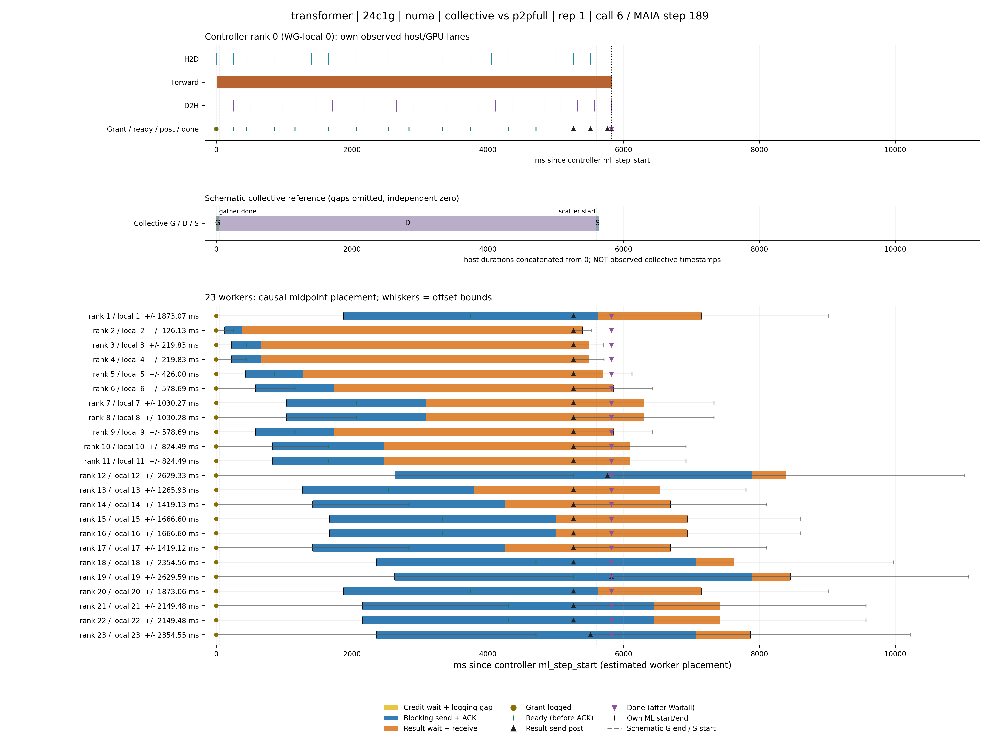

### mlp | 24c1g | default | collective vs p2p1 | rep 1 | call 6 / MAIA step 189

[timeline PDF](mlp_24c1g_default_p2p1_r1_call6_timeline.pdf)
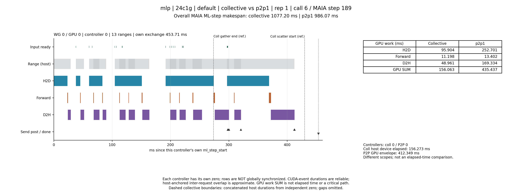

[rank_timeline PDF](mlp_24c1g_default_p2p1_r1_call6_rank_timeline.pdf)
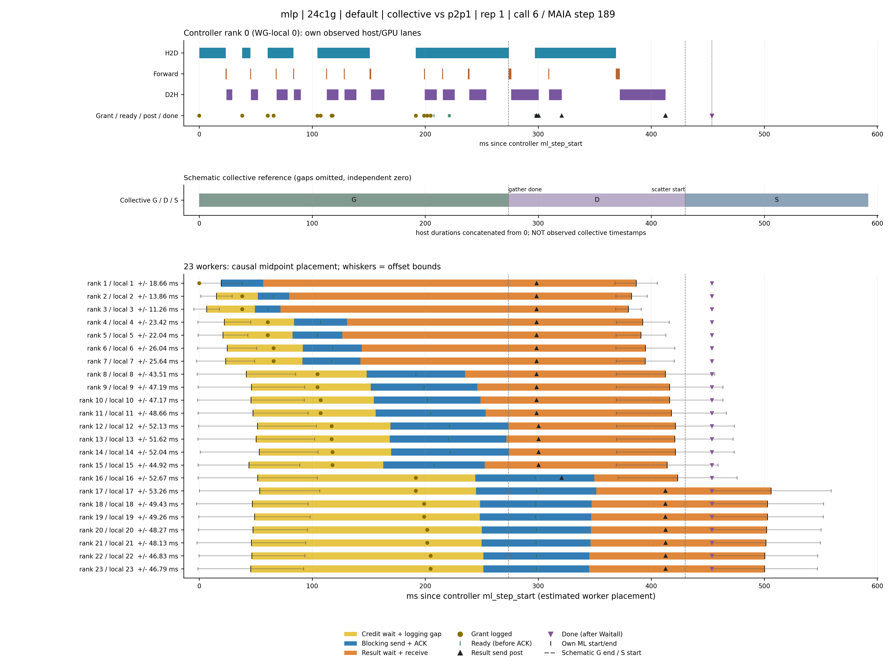

### mlp | 24c1g | default | collective vs p2pfull | rep 1 | call 6 / MAIA step 189

[timeline PDF](mlp_24c1g_default_p2pfull_r1_call6_timeline.pdf)
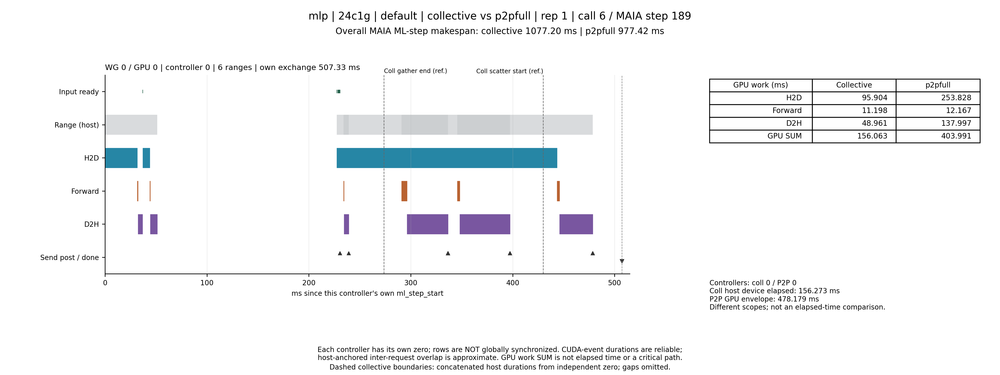

[rank_timeline PDF](mlp_24c1g_default_p2pfull_r1_call6_rank_timeline.pdf)
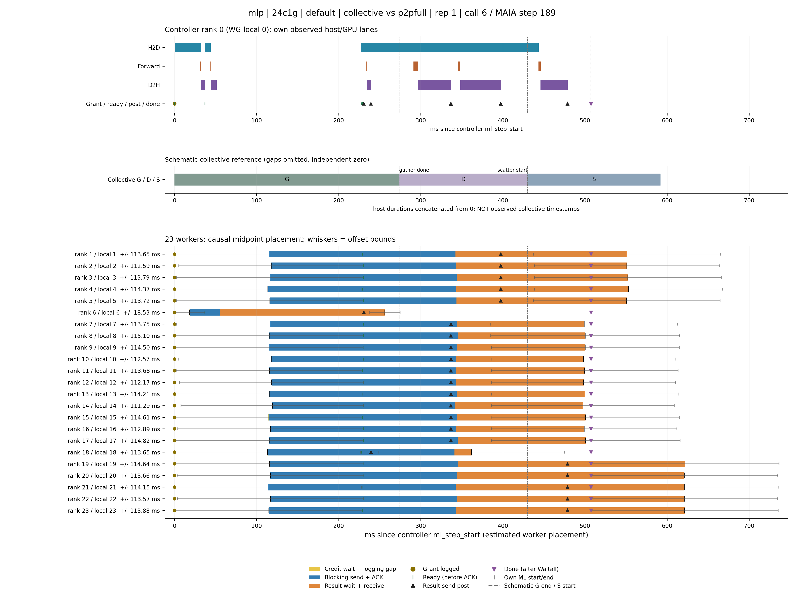

### mlp | 24c1g | numa | collective vs p2p1 | rep 1 | call 6 / MAIA step 189

[timeline PDF](mlp_24c1g_numa_p2p1_r1_call6_timeline.pdf)
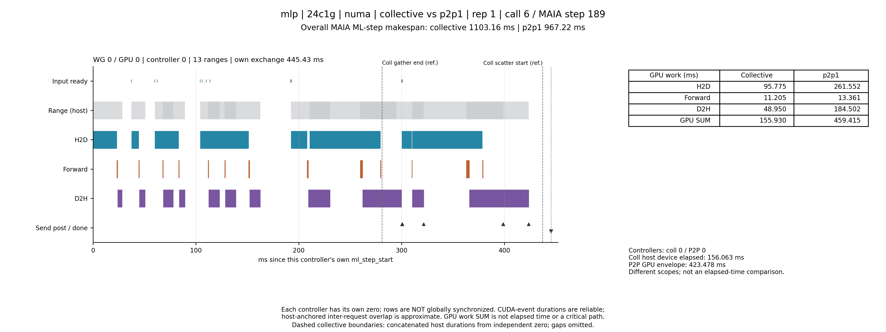

[rank_timeline PDF](mlp_24c1g_numa_p2p1_r1_call6_rank_timeline.pdf)
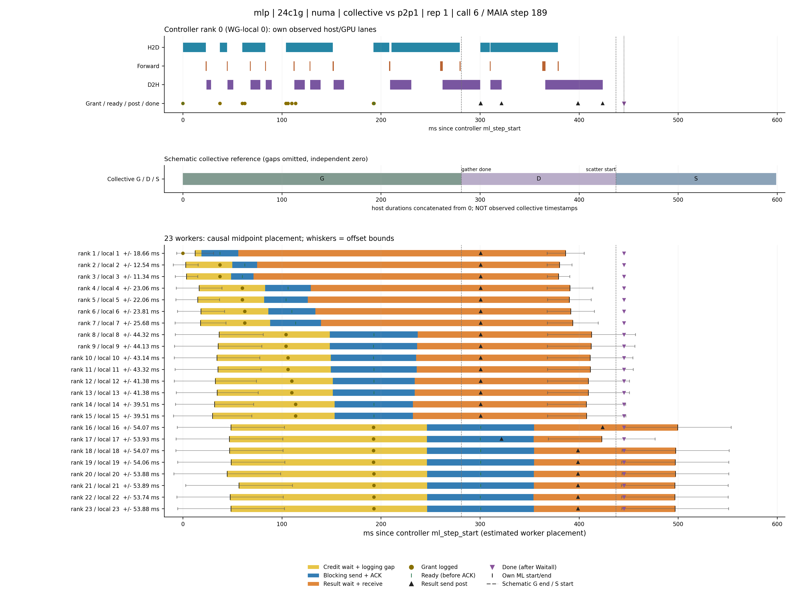

### mlp | 24c1g | numa | collective vs p2pfull | rep 1 | call 6 / MAIA step 189

[timeline PDF](mlp_24c1g_numa_p2pfull_r1_call6_timeline.pdf)
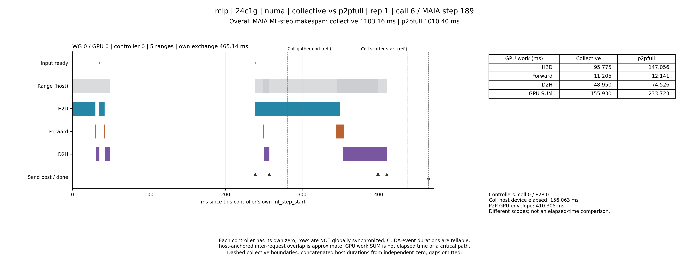

[rank_timeline PDF](mlp_24c1g_numa_p2pfull_r1_call6_rank_timeline.pdf)
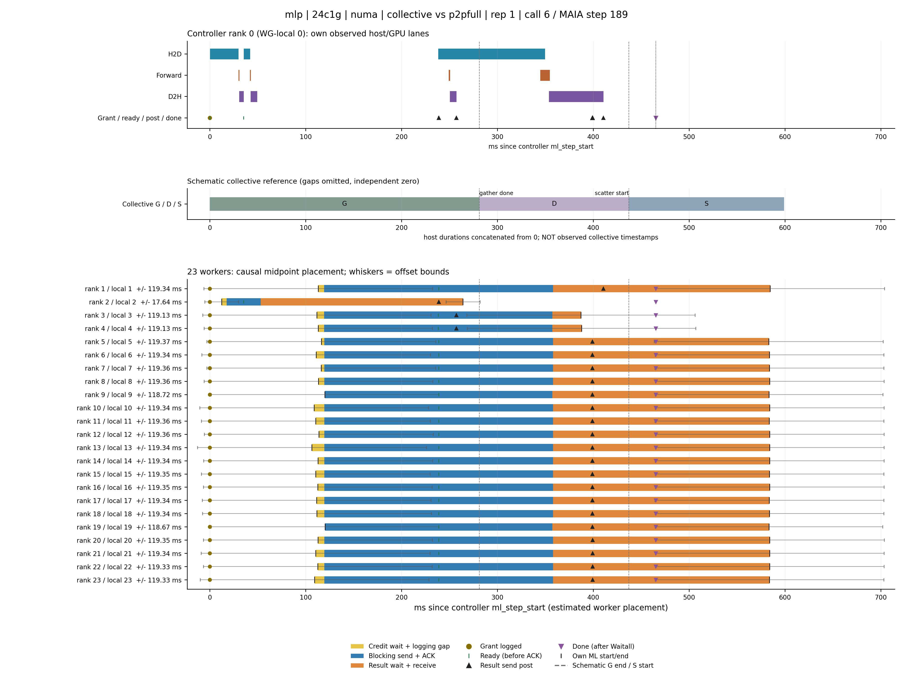

