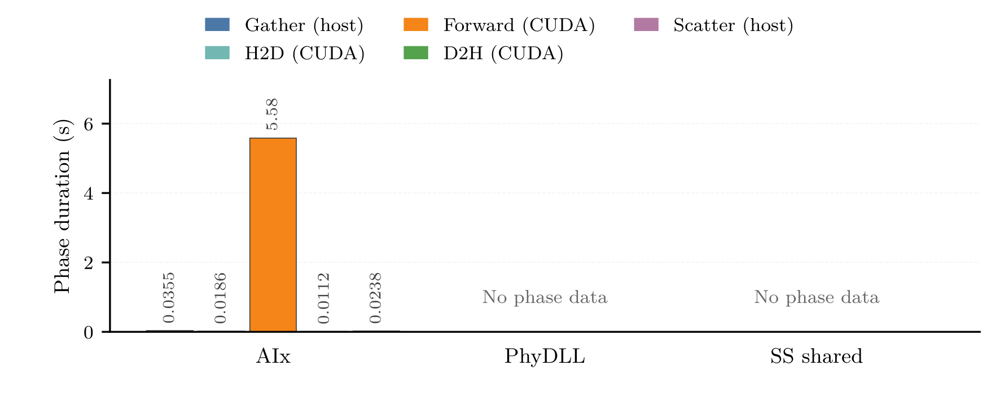
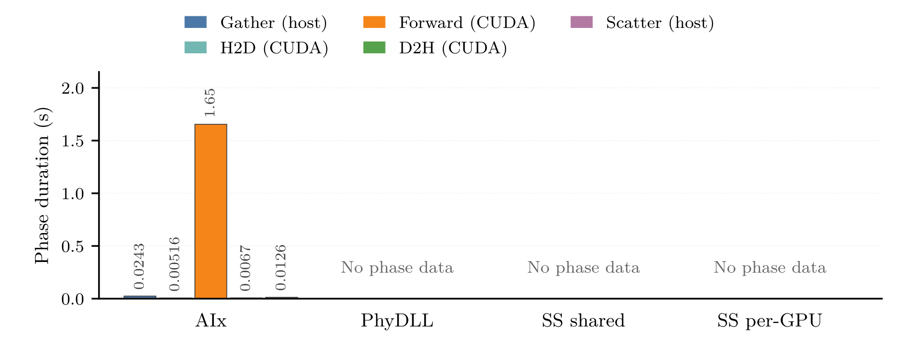
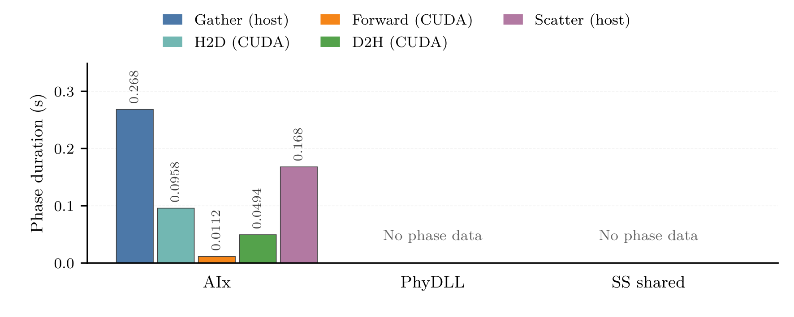
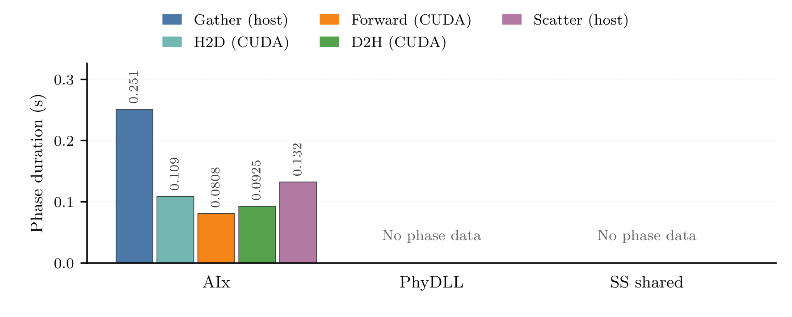
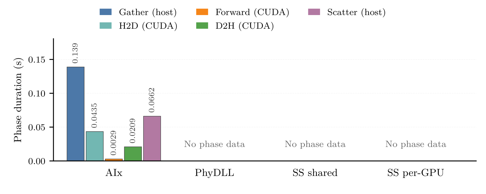
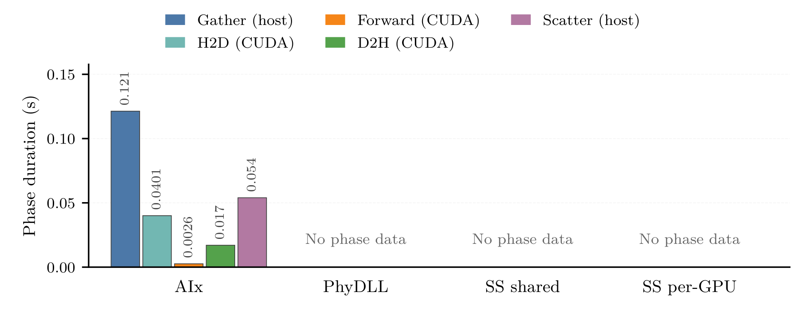

# Chapter 6 Provider Phases: Partial Draft

Eight 150 x 60 mm phase-only figures, PGF/PDF/PNG. This is NOT a complete
cross-provider phase comparison. Each has one measured AIx group with five
adjacent, zero-based phase columns; 20 provider groups lack phase measurements.
"No phase data" is a coverage annotation in axis coordinates, not data or zero bars.
The legend contains only the five measured AIx phases.
Graphics have no titles, subcaptions or explanatory footers in any format;
the embedding LaTeX caption owns model/hardware identification and caveats.
On 1 GPU shared DB and per-GPU DB are the same topology, shown only once.
On 4 GPUs the per-GPU dimension is absent: 2 models x 2 placements x 3 reps = 12 runs.

## Measured Scope

24 selected AIx default-collective runs, Transformer ov0 and MLP ov4, four
placements, three repetitions, five steady calls each (diagnostic 2..6,
one-based inference 3..7). The source loader validates all 72 collective runs
across layouts; only default is plotted here. Each call keeps the SAME WG
maximizing gather + H2D + forward + D2H + scatter (ties: lowest WG).
Average five vectors per run, then three run means. Never sum GPUs or take
independent phase maxima. The sum is used ONLY to select one WG per call, not as
a plotted duration. Each column shows its own phase mean, starting at zero.
Host and CUDA phases have distinct clocks/scopes; neither individual phases nor
their sum establish total ML-step latency or a global critical path. device_cpu
is not plotted alongside its CUDA subphases. Its signed discrepancy remains in the audit
tables; no clipping, invented Other, total-latency fractions, or CI.

## CPU Reference

Reference: ../smartsim/cpu_benchmark/figures/cpu_final/main/ and
plot_cpu_comparison.py, phase_panel / solver_summary(phase_only=True).
The CPU middle chart (transformer_comparison.png, visually inspected) uses
adjacent phase columns within provider groups, not stacks. This draft follows
that layout, zero baseline, rotated value labels, physical-width thesis output
and semantic palette, NOT CPU measurements. No stacked provider columns are used.
Exact CPU schemas: AIx Inference (#8064A2); PhyDLL Input receive (#4C78A8:
dl_recv + dl_frame_copy), Forward (#F58518: dl_torch_forward), Output send
(#54A24B: dl_send_output), Other (#BAB0AC: allocation/unpack/H2D/D2H/reorder).
SmartSim Put (#72B7B2: smartsim_put_tensor), Model request (#E45756:
smartsim_run_model), Retrieval/unpack (#B279A2: smartsim_unpack_tensor), Other
(#BAB0AC: smartsim_chunk_plan). These are NOT universal pack/transfer/wait bins.
GPU AIx extends the palette: host gather #4C78A8, H2D #72B7B2, CUDA forward
#F58518, D2H #54A24B, host scatter #B279A2. Similar colors express broad transfer
roles, not identical measurement scopes. No absent provider phase is in the
measured legend or plot_values.csv.

## Availability And Provenance

Selected PhyDLL production runs disable profiling; DL Score-P source regions do
not constitute measurements. Selected SmartSim controller logs describe lifecycle,
deployment and threading, not per-call phases. The loader rechecks selected raw
directories for .cubex/.otf2 and stops if new non-AIx profile evidence appears.
discovery.csv is a fresh bounded inventory of run.info, cases/manifest/combined
summary CSVs and .cubex/.otf2 in workspace
results/scratch, neighboring mini_app results/scratch, CPU campaign results/scratch,
and top-level historical Score-P roots. metadata.json records absent scopes,
depth pruning, timestamps, hashes and counts. Model hints come only from run.info
MODEL/MAIA/CELL/CASE or manifest model columns, not profile filenames.
Discovery is not proof of a matching
GPU run; unrelated CPU MAIA or GPU terrain profiles must not be substituted.
Coverage is limited to the explicitly listed roots, depth 10; not a filesystem-wide
claim. Raw source hashes and selected-cell hashes are in metadata.json; discovery
files and generated outputs have hashes too. Canonical results are unchanged.

Newer mini_app GPU campaigns (including gpu_refresh_20261013_optimized_profile_retry1)
have explicit cases.csv/manifest.csv model identities watercnn8k and giantmlp288;
retest_smartsim/summary_combined.csv likewise identifies those terrain models.
They do not provide MAIA Transformer/MLP GPU evidence. Nearby CPU steady-profile
run.info files identify build_cpu_steady_20261014_scorep and the CPU MLP model;
historical unpaired profiles remain unadmitted, not silently reclassified as GPU.

## Needed Capture Plan

A true full-provider measured phase graph is NOT possible from the selected
snapshot. Additional captures are BLOCKED pending parent authorization;
this script submits no jobs and changes no instrumentation or production config.

1. PhyDLL: 24 default GPU runs (2 models x 4 placements x 3 reps). The actual
   GPU launchers (slurm/run_cmi_smoke_gpu.sh and cmi_bench_het_engine.sh) execute
   the C++ phydll_dl_client, built from CPP-ML-Interface/dl_clients/dl_client.cpp
   by dl_clients/CMakeLists.txt, NOT the Python client. dl_client.cpp already has
   USE_SCOREP regions dl_input_allocate/dl_output_allocate, dl_input_unpack,
   dl_h2d, dl_torch_forward, dl_d2h, dl_output_reorder and dl_send_output.
   dl_clients/phydll_dl_runtime.cpp supplies dl_recv/dl_frame_copy/dl_send.
   include/provider/ml_coupling_provider_phydll.hpp supplies solver
   phydll_prepack/send/recv/unpack. Enable a separate Score-P build/capture or
   add per-call exports to these C++ sources after authorization. Existing
   regions measure host elapsed time, not CUDA-event durations: H2D/forward
   synchronize the current stream when PHYDLL_HAS_CUDA_STREAM is enabled, and
   dl_torch_forward includes output assembly. Add CUDA events for genuine
   device-only H2D/forward/D2H attribution; do not relabel host regions as such.
   Retain rank, call, GPU mapping and model hash; exclude two warmups. Do not
   add overlapping solver waits to DL work or count dl_send_output and its
   dl_send descendant twice. Selected production captures remain unavailable.
2. SmartSim shared: 24 instrumented GPU runs. Add per-call host timers around
   chunk planning, put, model request, and get/unpack in
   CPP-ML-Interface/include/provider/ml_coupling_provider_smartsim.hpp.
   Controller lifecycle logging alone cannot supply these. RedisAI/backend tracing
   is additionally required for genuine GPU forward/H2D/D2H attribution; client
   model-request elapsed time is NOT forward time. Preserve all selected TPQ,
   intra/inter-op, batching, overlap and sequential-put settings.
3. SmartSim per-GPU: 12 new runs on the two 4-GPU placements with both models,
   three reps; include the same phase instrumentation and DB-to-GPU provenance.
   Do not duplicate the 1-GPU shared measurements as independent observations.
4. For all captures: retain two warmups + five steady calls, explicit per-call
   scope, rank/GPU identity, model/config/binary hashes, exit status, and unprofiled
   controls to assess instrumentation perturbation. Keep new captures separate
   from the selected production snapshot. Provider-semantic adjacent phase
   columns become possible after capture; a common critical-path decomposition
   needs aligned causal traces and cannot be inferred by renaming these phases.

## Reproduce

`python scripts/plot_cmi_ch6_phases.py`

`python -m unittest discover -s scripts -p 'test_plot_cmi_ch6_phases.py'`

plot_values.csv contains only measured AIx phases, exact run means and sample SD.
coverage.csv has blank duration fields for missing providers. selected_calls.csv
and workgroup_calls.csv retain the measured vectors and candidate WGs.

## Fresh Inventory Counts

439 manifest, 707 profile, 432 run_info. See discovery.csv for paths, dates, model provenance and hashes.

## transformer_24c1g_phases
[PGF](transformer_24c1g_phases.pgf) | [PDF](transformer_24c1g_phases.pdf)

## transformer_24p24c1g_phases
[PGF](transformer_24p24c1g_phases.pgf) | [PDF](transformer_24p24c1g_phases.pdf)

## transformer_96c4g_phases
[PGF](transformer_96c4g_phases.pgf) | [PDF](transformer_96c4g_phases.pdf)

## transformer_96p96c4g_phases
[PGF](transformer_96p96c4g_phases.pgf) | [PDF](transformer_96p96c4g_phases.pdf)

## mlp_24c1g_phases
[PGF](mlp_24c1g_phases.pgf) | [PDF](mlp_24c1g_phases.pdf)

## mlp_24p24c1g_phases
[PGF](mlp_24p24c1g_phases.pgf) | [PDF](mlp_24p24c1g_phases.pdf)

## mlp_96c4g_phases
[PGF](mlp_96c4g_phases.pgf) | [PDF](mlp_96c4g_phases.pdf)

## mlp_96p96c4g_phases
[PGF](mlp_96p96c4g_phases.pgf) | [PDF](mlp_96p96c4g_phases.pdf)

