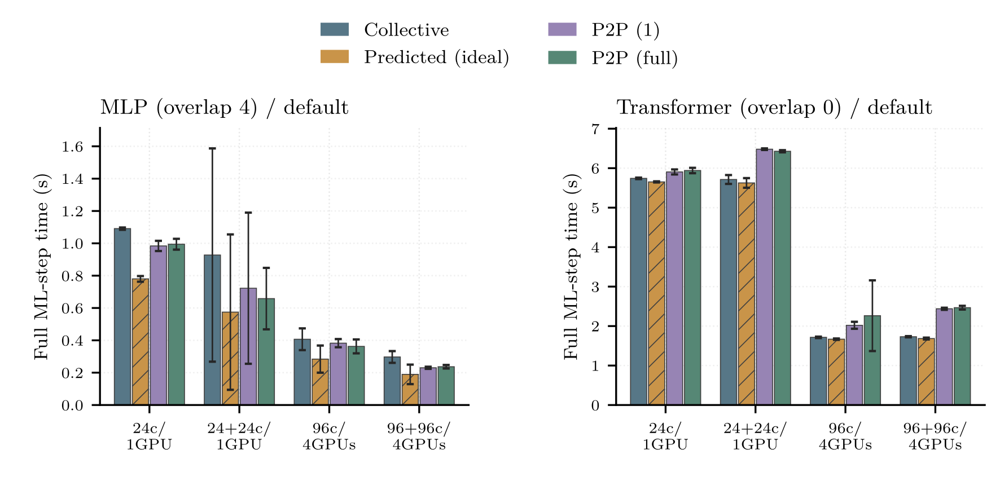
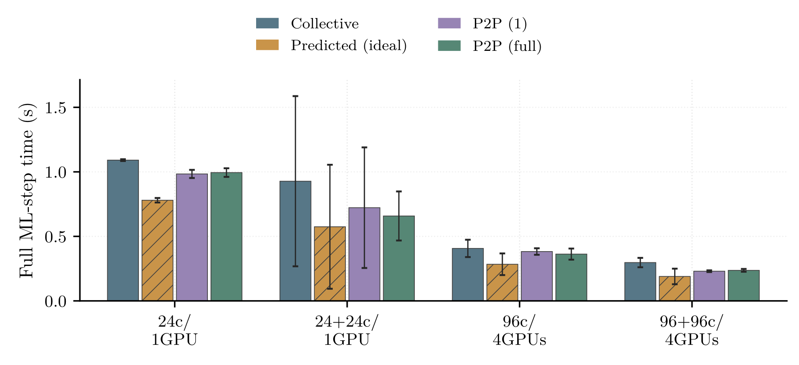
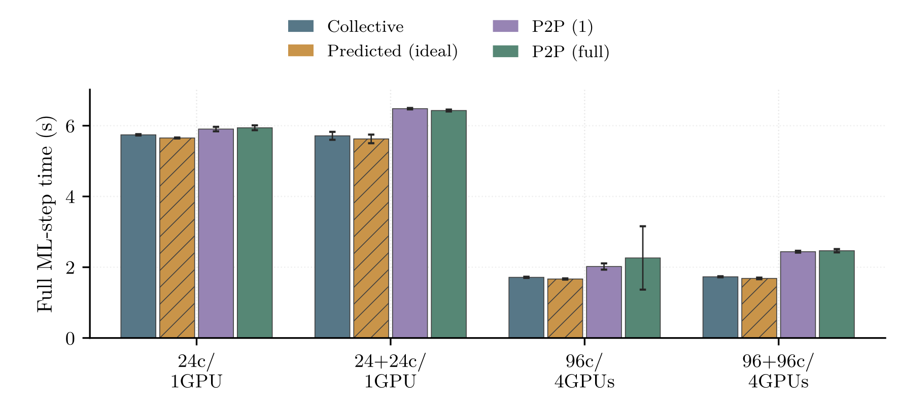
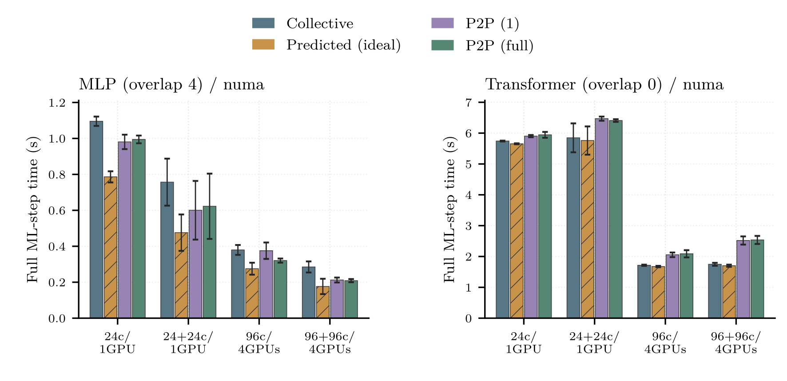
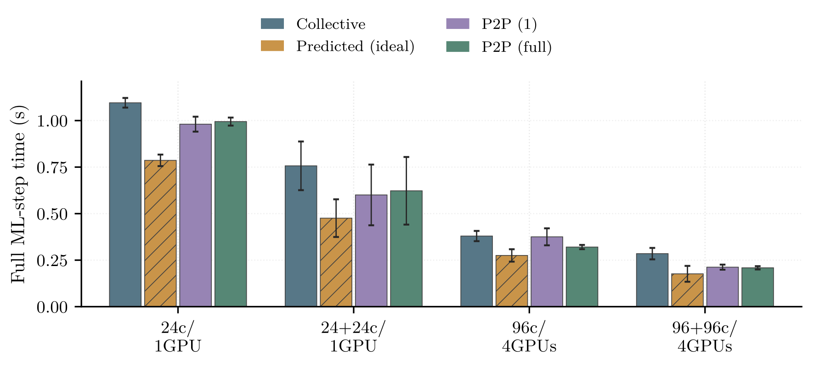
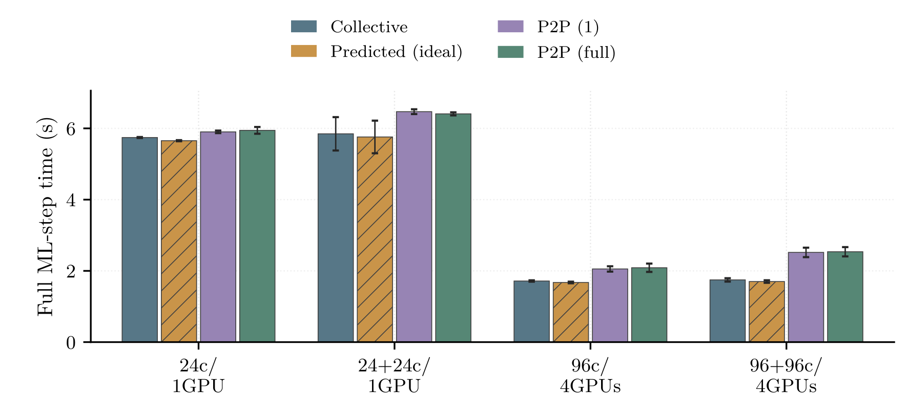

# Chapter 7 Pipeline Prediction Draft

## Definition
Thesis chapter_optimizations.tex lines 274--405, especially equations tau_step,
tau_max, collective and pipelined, is the model source (hashed in metadata.json).
For N workgroup members INCLUDING the controller (not GPU count),
tau_step = sum(tau), tau_max = max(tau), T_collective = N sum(tau),
T_pipeline = sum(tau) + (N-1) max(tau), savings = (N-1)(sum(tau)-max(tau)).
The synthetic N=10 example is 380 -> 218 ms.

## Collective Adapter
A_g = (1000 gather_collective_s, h2d_gpu_ms, forward_gpu_ms, d2h_gpu_ms,
1000 scatter_collective_s); tau_g = A_g/N_g.
Thus P_g = sum(A_g)/N_g + (N_g-1)/N_g max(A_g) and
savings_g = (1-1/N_g)(sum(A_g)-max(A_g)). No GPU-count scaling.
These are amortized hypothetical per-rank stages, NOT measured rank service times.
Only the mapped controller row is used; rank 0 is not an aggregate, and controller
identity is taken from base.parse_mapping(solver.log), never rank modulo GPU count.
The controller's local input is still counted in N, as in the thesis idealization.
Collective gather/scatter durations include protocol, waiting and possible imbalance:
amortizing them assumes baseline equivalence, homogeneous ranks and scalable service.
CUDA-event sums cover all serial collective sub-batches and exclude host overhead.
device_cpu_s is exported as a diagnostic ONLY: it is not added to the GPU stages,
and device_cpu minus GPU work is not assumed to be a precise CPU overhead measure.
GPU work in P2P can overlap; its phase SUM is diagnostic work, not elapsed time.
All modes' GPU diagnostics cover all 3 repetitions and all 5 measured calls.

## Job-Level Proxy
B = max_g sum(A_g), P = max_g P_g, savings_job = B-P.
predicted full ML-step = observed collective full ML-step - savings_job.
This is the difference of independent ZERO-ORIGIN WG phase envelopes, NOT a measured
global critical path or synchronized makespan. WG temporal origins are unknown;
the critical WG may switch (both identities exported). GPU savings are NEVER summed.
The observed residual R = observed collective - B is retained unchanged:
prediction = R + P. The observed baseline is never replaced by a stage sum.
Even negative residuals are retained and counted; they expose scope/instrumentation
differences rather than establish literal overhead. Negative predictions raise,
never clamp. This adapter is a conditional ideal scenario, not a guaranteed bound
on measured P2P speedup. It assumes homogeneous ranks, independent stages, unchanged
batch efficiency and non-stage residual, no inter-WG contention, and baseline
equivalence. It ignores the implementation's serialized input/output communication,
batch-size effects, local controller shortcuts and rank readiness differences.

## Scope and Statistics
Canonical consolidated 288 runs only; no retry-directory discovery. Successful AIx
default/numa coll,p2p1,p2pfull cells for MLP overlap 4 and Transformer overlap 0.
Each mode is paired by model, hardware, layout and repetition, with exact logged
WG/GPU membership equality. Diagnostic calls 2..6 map to canonical inference calls
3..7 and MAIA steps 73,102,131,160,189. First two calls are excluded.
Observed bars use canonical inferences.csv full MAIA ML-step elapsed, NOT controller
elapsed. Stages have controller-local single-call scope; no cross-clock rate or
throughput comparison is made. Hardware groups are not fixed-work strong scaling.
Prediction is computed per call, then five-call means per run, then across three
independent repetitions. CI = mean +/- 4.302652729911275 SD/sqrt(3), SD ddof=1,
95% Student t df=2. These CIs show repetition variability, not model uncertainty.
Calls and GPUs are not independent samples. Negative CI bounds are retained.
No repetition dots. Four modes times four hardware groups = 16 bars per model/layout.

## Outputs and Sizing
Each layout has a combined ONE-ROW preview (MLP left, Transformer right) plus two
independent panels intended for LaTeX. Every canvas is 150 mm wide; independent panels
are 68.6052 mm high and previews 72.8052 mm high. The measured plotting-axis height
remains 41.6052 mm; removed footer/title margins do not stretch the data area.
Independent panels use the FULL 150 mm thesis text width, not 73.5 mm half-width;
the combined preview necessarily uses smaller ticks and is for overview only.
Use independent PDFs at width=\textwidth; PGF requires the thesis Latin Modern
preamble. thesis_style supplies PGF + pdflatex PDF + PDF-derived 300 dpi PNG.
No tight bounding-box cropping, so physical width stays invariant.
Independent panels have no embedded titles or subcaptions in PNG, PDF or PGF.
Supply model, overlap and layout in LaTeX subcaptions: MLP overlap 4, Transformer
overlap 0; filenames identify default/numa layout. Combined previews retain only
these model/overlap/layout headers for identification, without (a)/(b) labels.
Statistical explanations and prediction-proxy caveats appear only in captions/README,
never inside graphics. The predicted-series legend and hatch remain data identifiers.

## Font Style
All formats use thesis_style's pdflatex/Latin Modern typography, without enlarging
fonts to fill removed margins. Independent ticks are 9 pt and axis labels 10 pt;
overview ticks are 6.5 pt, labels 8 pt and model headers 9 pt. Legends remain 8 pt.

workgroup_call_stages.csv: raw collective inputs, adapted A/tau, N, mapping,
all-mode GPU phase work and diagnostic source paths, one row per WG/call.
call_predictions.csv: before/after envelopes, critical WG switch, residual,
savings and observed/predicted full-step per collective call.
call_values.csv: observed and predicted call-level values for all bars.
plot_values.csv: three run means, SD, CI and plotted means (all in ms).
metadata.json: selected canonical rows, counts, SHA256 of all consumed inputs,
controller diagnostics, mappings, thesis, guide, helper and script/style sources.

## Gallery

### default_combined_preview
[PDF](default_combined_preview.pdf) | [PGF](default_combined_preview.pgf)



### default_mlp
[PDF](default_mlp.pdf) | [PGF](default_mlp.pgf)



### default_transformer
[PDF](default_transformer.pdf) | [PGF](default_transformer.pgf)



### numa_combined_preview
[PDF](numa_combined_preview.pdf) | [PGF](numa_combined_preview.pgf)



### numa_mlp
[PDF](numa_mlp.pdf) | [PGF](numa_mlp.pgf)



### numa_transformer
[PDF](numa_transformer.pdf) | [PGF](numa_transformer.pgf)



## Validation Counts
```json
{
  "selected_runs": 144,
  "workgroup_calls": 1800,
  "call_values": 960,
  "call_predictions": 240,
  "plot_values": 64
}
```

Negative residuals retained: 0; negative CI bounds retained: 0; negative predictions: 0.
