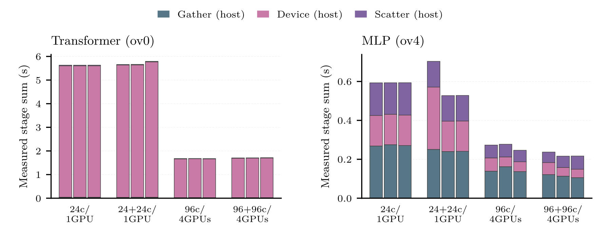
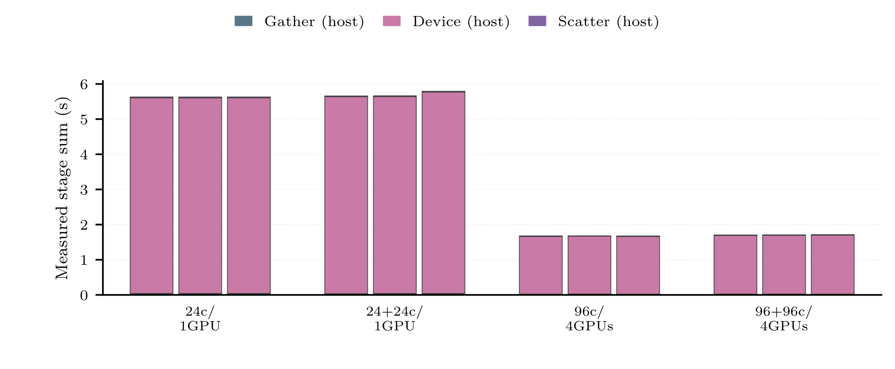
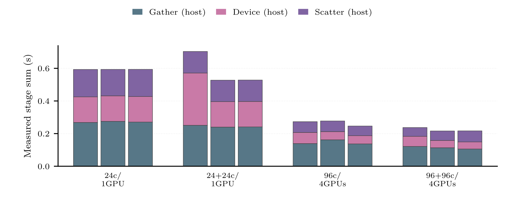
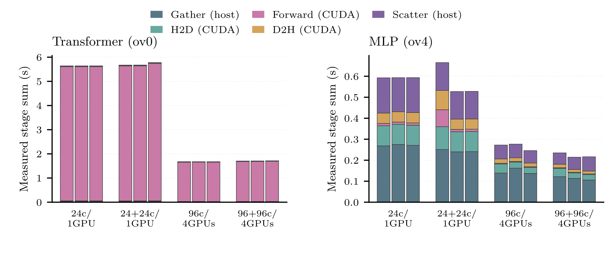
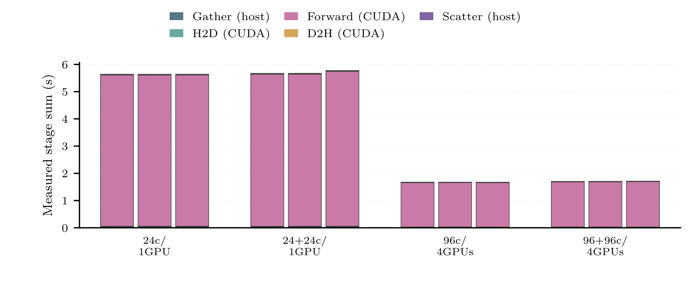
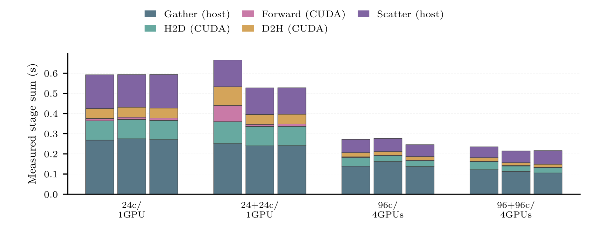

# GPU Phase-Only Drafts

Six figures, each as PGF/PDF/PNG: host3 and measured5, each as a 150 mm two-model row and two 150 mm standalones. All canvases are 150 x 62 mm. Transformer ov0; MLP ov4. No memory or ML-step bars.

Graphics contain no explanatory footers or subcaptions in any format. Standalones are title-free; two-model rows retain model headings for panel identification. The embedding LaTeX caption owns titles and explanatory notes. Within each hardware group, bars run left to right: default, affine, NUMA.

## Scope And Aggregation

All 72 canonical AIx collective runs: 2 models x 4 hardware placements x 3 layouts x 3 repetitions. Diagnostic calls 2..6 (one-based inference calls 3..7) are measured; calls 0,1 are excluded. Each stack retains all phases of the SAME controller/WG maximizing the sum for that scope/call. Host3 and measured5 may therefore select different WGs. Ties choose the lowest WG. Five call vectors are averaged per run, then three run vectors are averaged. No sum across GPUs, no independent phase maxima, no global critical-path claim, no CI dots/whiskers.

Host3 uses steady_clock gather/device/scatter durations on a controller; device_cpu includes GPU work. These are native CPU-clock durations during GPU runs, NOT CPU-only benchmark observations. Interstage gaps and other solver/library operations are omitted.

Measured5 uses host gather, CUDA-event H2D/forward/D2H batch sums, and host scatter. It is a mixed-clock measured-stage sum, NOT continuous elapsed time or total ML-step latency. The signed residual device_cpu - sum(CUDA phases) is retained in workgroup_calls.csv and selected_calls.csv. It can be negative, is never clipped, and cannot be called measured overhead or stacked as an exclusive phase. Do not add device_cpu to CUDA durations. No fictitious Other phase is inferred.

## Provider Coverage

coverage.csv audits all 288 selected cells. AIx: 72 collective runs rendered; 144 P2P runs have request timelines but not this collective five-stage scope. PhyDLL: 48 runs, no matching selected phase profiles; DL-side Score-P regions exist in source, but current production runners disable profiling. SmartSim: 24 runs, controller.log gives deployment/DB/thread/lifecycle diagnostics, not per-call put/model-request/get/unpack timings. Selected directories are searched recursively for .cubex/.otf2 artifacts; any new non-AIx profile evidence stops rendering for review. This bounded audit does not assert that unrelated historical profiles cannot exist.

CPU renderer reference: ../smartsim/cpu_benchmark/plot_cpu_comparison.py phase_panel and solver_summary(phase_only=True): phase-only grouping and physical-width thesis exports. No CPU/terrain observations, historical unpaired profiles, total-latency fractions, or zeros substitute for missing provider phases. Consequently no cross-provider phase figure is rendered.

## Reproduction

`python scripts/plot_cmi_gpu_phases.py`

plot_values.csv contains exact plotted phase means, three run means and their sample SDs. selected_calls.csv records each selected controller/WG; workgroup_calls.csv retains all candidates, mapping, batch counts and signed residuals. metadata.json hashes the canonical inputs, raw logs, controller diagnostics, renderer/style and instrumentation sources, and records selected rows. No changes are made to canonical results or results/cmi_aix_stage_tables.

## aix_collective_host3_transformer_mlp

[PGF](aix_collective_host3_transformer_mlp.pgf) | [PDF](aix_collective_host3_transformer_mlp.pdf)

## aix_collective_host3_transformer

[PGF](aix_collective_host3_transformer.pgf) | [PDF](aix_collective_host3_transformer.pdf)

## aix_collective_host3_mlp

[PGF](aix_collective_host3_mlp.pgf) | [PDF](aix_collective_host3_mlp.pdf)

## aix_collective_measured5_transformer_mlp

[PGF](aix_collective_measured5_transformer_mlp.pgf) | [PDF](aix_collective_measured5_transformer_mlp.pdf)

## aix_collective_measured5_transformer

[PGF](aix_collective_measured5_transformer.pgf) | [PDF](aix_collective_measured5_transformer.pdf)

## aix_collective_measured5_mlp

[PGF](aix_collective_measured5_mlp.pgf) | [PDF](aix_collective_measured5_mlp.pdf)

